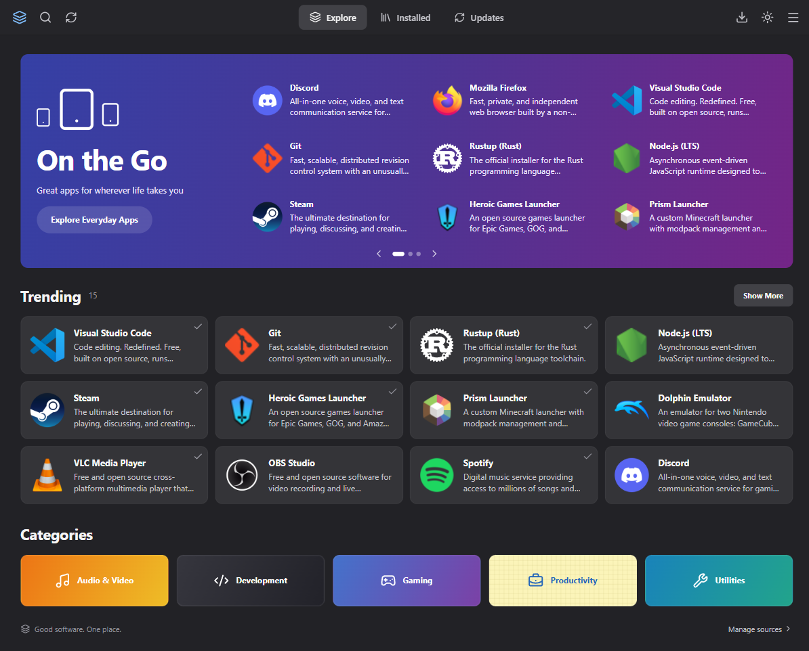
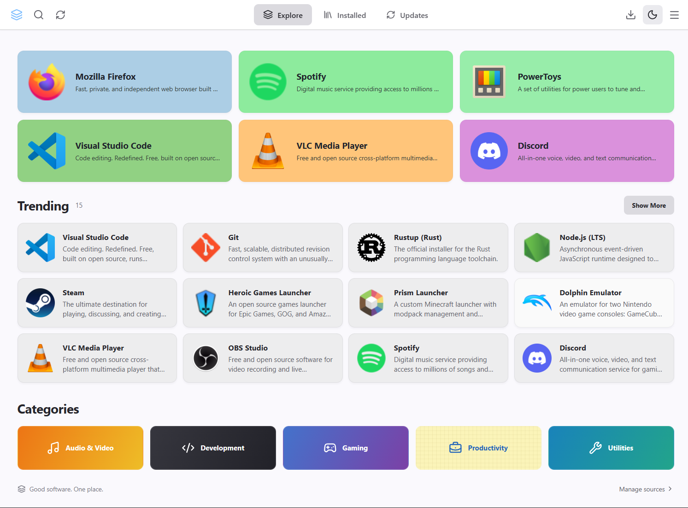
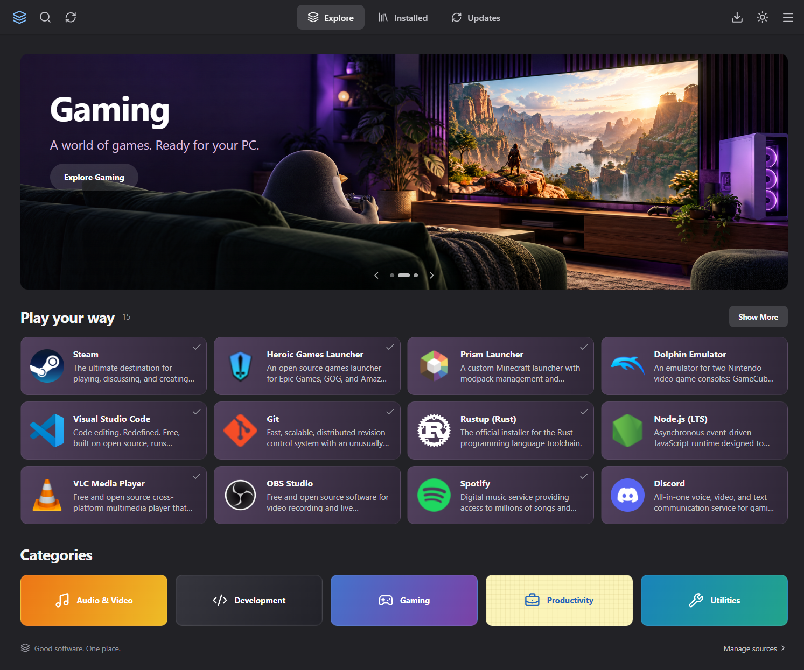
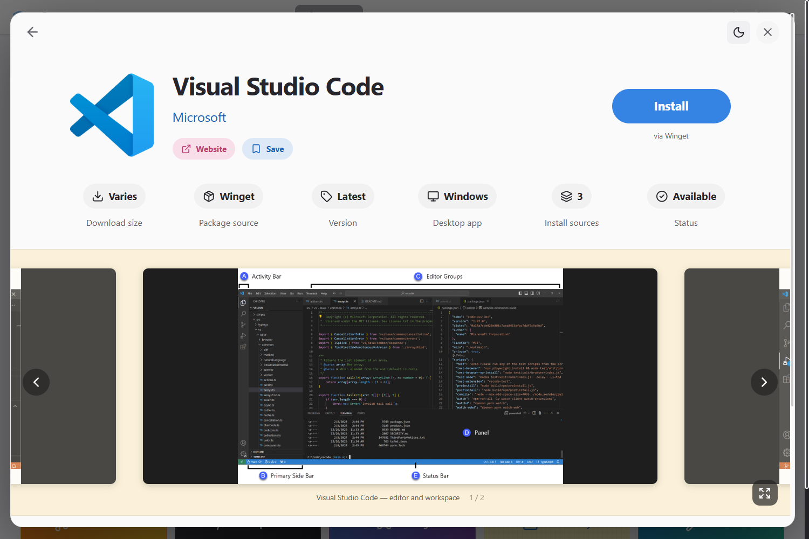
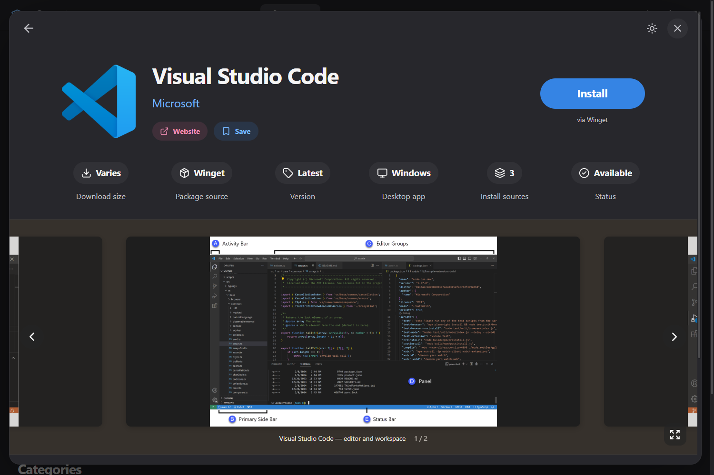
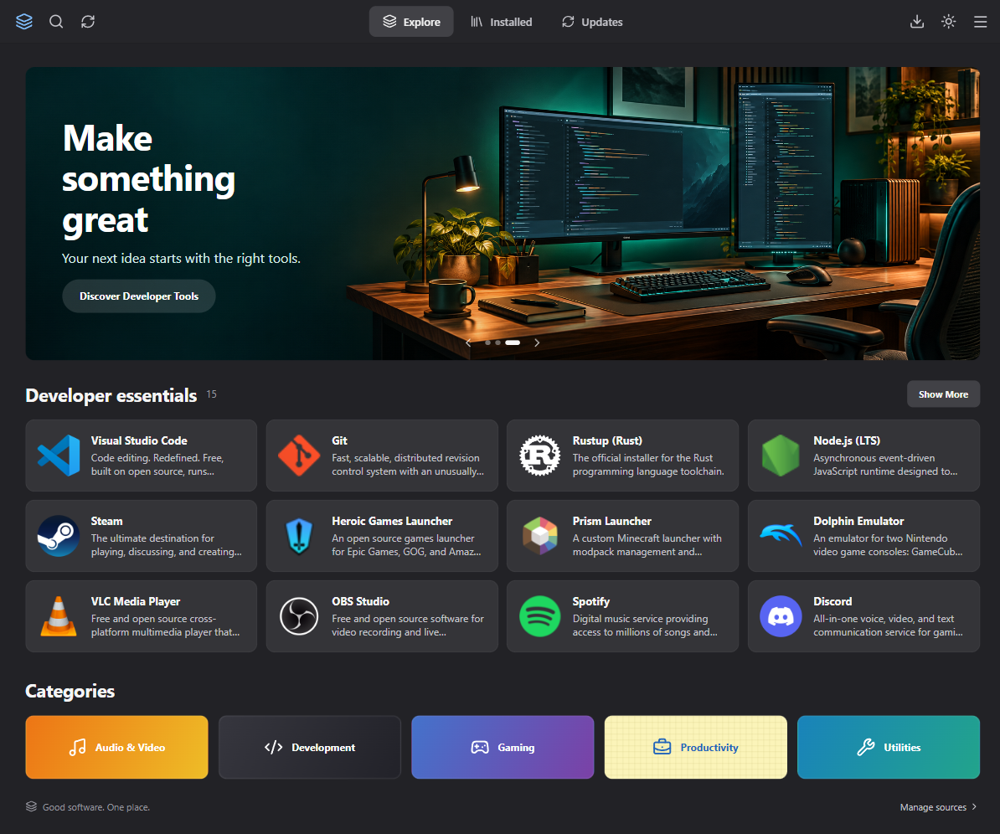

# Winstore

A Windows software catalog with a compact Bazaar-inspired interface and a choice of Winget, Scoop, or Chocolatey for supported packages.



The interface includes a feature carousel, compact app shelves, colorful category tiles, a light theme, searchable catalog, package details, and a task drawer. Package-manager output is available for completed and failed tasks; active operations show an indeterminate indicator because the CLI does not supply download percentages.

## Run

Install the project dependencies with `npm ci`, then launch the desktop app:

```powershell
npm run tauri dev
```

Requires Node.js compatible with the installed Vite version, a Rust toolchain, the Windows C++ build tools, and WebView2. An available package manager is required for package actions; browsing the curated catalog does not require one.

```powershell
npm run build
cargo test --manifest-path src-tauri/Cargo.toml --lib
cargo clippy --manifest-path src-tauri/Cargo.toml --all-targets -- -D warnings
npm run tauri build
```

Production executables and installers are generated under `src-tauri/target/release/`.

For the unsigned installer and a portable ZIP, run `./scripts/build-windows.ps1` in PowerShell 7. To package an existing release without rebuilding, run `./scripts/package-portable.ps1`. The ZIP is written to `src-tauri/target/release/bundle/portable/`; extract it and run `Winstore.exe`. It requires WebView2 and keeps settings/history in your Windows user profile, so the executable is portable while its data stays on that PC.

## Current capabilities

- The 144-app curated catalog includes 109 verified Scoop mappings with bucket-qualified IDs. Scoop is preferred for new installs where available; detected installations open with their existing manager.
- Search filters curated metadata by enabled sources, queries Winget, and searches package names in configured Scoop buckets. Scoop versions come from local manifests; run `scoop update` to refresh them. Chocolatey live repository search is not implemented.
- Installed/update detection reads all three managers, including packages outside the curated catalog. Details show the installed version, manager, update version, and Scoop user/global scope. Winget detection does not establish the original installer; ambiguous or overlapping registrations have destructive actions disabled.
- Package actions recheck the selected installation before update/removal and refresh inventory afterward. A successful command does not automatically mark an app installed or removed. See [inventory and Scoop search](docs/INVENTORY_AND_SCOOP.md).
- Installation, update, and removal run through the selected package manager. Available sources are detected on this PC. Installers may display additional windows or request administrator permission.
- The backend queue runs one task at a time with live output, cancellation, configurable timeout, explicit retry, and persistent history. Restarted tasks are marked interrupted and are never automatically replayed. Cancellation does not undo installer changes.
- Saved apps have a dedicated page. Sorting, source choices, 100–130% text size, task timeout, and update-check preferences persist locally.
- App details show source-reported versions, architecture, size, and release information, with unknown fields labeled honestly.
- Windows installers are unsigned as requested. HTTPS update checking and manual installer downloads are supported when a real feed is configured; this checkout has no hosted feed. See [task, metadata, and installer behavior](docs/TASKS_DETAILS_AND_UPDATES.md).
- App icons are bundled in `public/icons/`; a missing icon uses a neutral fallback. Logos belong to their respective projects. See [asset sources](docs/ASSET_SOURCES.md).

## Screenshots





The original comparison photos are in `assets/ui-reference/`. They are design references, not screenshots of Winstore. The architecture document describes the original roadmap; the capability list above describes the current implementation.


## App details

Click an app to open the wide details view, with dark/white themes, source selection, saved apps, and real screenshot previews where available.








## Default app catalog

The bundled catalog has 144 apps across eight categories, including the requested browsers, communications tools, development tools, document apps, game launchers, media apps, WinRAR, and 7-Zip. Amazon packages are excluded. Use the category filters or Show More to browse the catalog without running a search. See [catalog mapping and verification](docs/CATALOG_EXPANSION.md).


The **Artcraft** collection includes all 13 individual Craft apps with local icons and screenshots. Seven have verified Winget entries; all 13 offer the publisher's standalone Windows installer. The Artcraft launcher is excluded. See [Artcraft app mappings](docs/ARTCRAFT_APPS.md).
